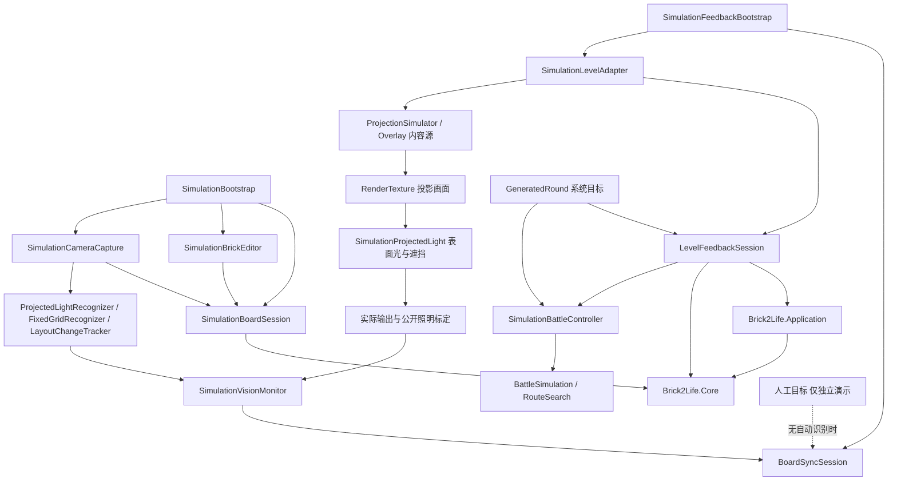

# Brick2Life 架构

更新：2026-11-07。适用于当前 Brick2Life-C 本地工作树，未提交改动不等于远端状态。A/B/C 已接线，当前包含独立 RGB 预测与稳定确认、固定虚拟投影仪、实时塔防及双窗口。默认玩法由系统生成一个固定核心与 1–4 个入口，玩家只编辑墙塔；堵路时警告并继续旧路线。操作和验收见 [系统目标玩法](generated-defense-round-guide.md)、[固定投影仪仿真](physical-projector-guide.md)。

## 模块与依赖

- Core 不引用 Unity 或其他项目模块。Contracts 集中公共类型，BoardLayout 维护可编辑布局，BoardDelta 计算格位变化。
- Application 仅引用 Core。BoardSyncSession 拥有视觉确认状态；方法在同一线程调用，异步 B 的结果由集成入口切回所属线程。
- Application 的 DatasetPlan 定义有限的日常测试布局、稳定种子及逻辑内容分组；它不修改公共棋盘合同。Editor 负责隔离采集任务，采集由 Simulation 适配；Simulation 的实际程序集依赖见下文。
- Application 另含任务 C 的纯逻辑：LevelSemantics（颜色→角色、关卡状态与合法性）、ProjectionPlan（逐格投影标记）、LevelFeedbackSession（消费 BoardUpdate 产出反馈帧），以及 GeneratedRound（可复现系统目标）。均不引用 Unity。
- Simulation 引用 Core、Application、Vision 和 Unity UI，承担引擎具体实现。Bootstrap 组装棋盘、编辑界面、采集，并在运行时挂载识别面板 `SimulationVisionMonitor`。
- `Brick2Life.Vision` 不引用 Unity：`VisionCalibration`（调色板色样）、`CameraProjection`（固定格位采样）、`FixedGridRecognizer`（干净 RGB 分类）、`ProjectedLightRecognizer/PhotometricProfile/CellProjection`（已知照明下的颜色恢复、饱和拒绝与分类）、`LayoutChangeTracker`（连续帧稳定与变化事件）、`RecognitionScore`（与真值对照的准确率）。
- 连续识别直接读取 C 的真实带投影 RGB。`IProjectionObservationSource` 只传公开投影输出和标定系数；C 不把真实占用、颜色、ID、接收物材质或深度传给识别。独立灰参考标定、Gamma 响应、顶面/桌面图像假设及识别相机固定曝光见 [投影指南](physical-projector-guide.md)。运行时没有干净图再合成的旁路。F8/顶部按钮仅切换连续识别与暂停识别，保留确认布局，丢弃待确认计数。暂停模式只在暂停期间保持关投影并采集，继续/开战前使用控制器的新确认等待机制；完成后恢复显示。周期性消隐状态、参数与采样 API 已删除。
- 识别面板 `SimulationVisionMonitor` 拥有唯一的 `BoardSyncSession`：每帧采样 → 识别 → 连续三帧稳定后 `BeginFrame/Confirm`，再通过 `UpdateApplied` 事件把 `BoardUpdate` 交给任务 C；面板底部另有一行显示任务 C 的关卡与投影摘要。
- Feedback 引用 Core、Application、Battle、Vision、Simulation 和 Unity UI，是任务 C 的引擎侧：`SimulationFeedbackBootstrap` 在存在识别面板时共享其 `BoardSyncSession`（否则自建会话供人工目标演示），`SimulationLevelAdapter` 把 `BoardUpdate` 变成关卡对象与投影标记。`ProjectionSimulator` 与 `SimulationBattleOverlay` 生成图像内容，`SimulationProjectedLight` 汇成一张纹理并从固定透视位置投射到表面，按接收物颜色和法线叠加光照、按投影仪深度图遮挡。源面片默认不直接绘制。
- `Brick2Life.Battle` 不引用 Unity：`BattleLevel` 把确认关卡（10×10）映射成 20×20 战斗格并校验入口通路，`RouteSearch` 做四方向 A*，`BattleSimulation` 以 1/60 固定步长跑波次、塔与核心；`SimulationBattleController/View/Panel` 只负责驱动、渲染和参数输入。
- Editor 引用 Core、Application、Battle、Vision、Simulation、Feedback 和 Unity UI，仅 Editor 编译，承载灯光配置、任务 C 安装与分层检查、战斗装置安装、依赖检查与构建。

Awake 顺序为棋盘会话 -200、接线 -100、任务 C 反馈入口 -50，随后战斗控制器生成目标，编辑界面 Start。自动视觉输入启用时，点击 `开始` 后等待 B 的新采集确认。战斗中允许编辑墙塔，新确认 LevelState 通过 `BattleSimulation.TryUpdateLevel` 更新地图、入口路线、存活敌人余程与塔，保留敌人位置与血量、波次、核心生命、时钟及用户暂停。不读取原始棋盘内容判断识别是否正确。

默认控制器启用 `keepLastValidRoutes`：全部入口可行时立即更新入口路线及可连接旧敌人的余程；暂时无法连接的旧敌人各自保留旧路，`PendingEnemyReroutes` 记录待连接数量，进入其他导航格后自动尝试重寻路。入口确实无路时采用新确认墙塔、保留完整 `ActiveRoutes` 与原敌人余程，设置 `UsingPreviousRoutes/RouteWarning`，继续战斗。结构错误仍以 `WaitingForLayout` 等待修复。`BattleLevel.Entrances` 保存完整入口，包含候选无路的入口，避免部分成功路线压缩后错配出生索引。旧手动核心 fixture 保持默认关闭回退，以验证兼容行为。

`RouteSearch` 保留半格四邻接节点，但只连接物理空格中心，混合奇偶节点用于垂直穿越格边，格角不用于正常选路。墙/塔四邻接的中心节点附加软代价，宽路优先，一格窄路仍可行。入口路径与存活敌人重寻路使用同一代价，敌人和 `SimulationBattleOverlay` 消费同一路径，绘制侧不单独偏移路线。

## 状态归属

| 状态 | 写入者 | 跨模块表达 |
| --- | --- | --- |
| 仿真真实布局 | SimulationBoardSession 中的 BoardLayout | Simulation 来源的冻结快照，供采集/评价 |
| 视觉候选 | B | FrameObservation，允许占用/颜色未知或整体拒绝 |
| 视觉确认布局 | BoardSyncSession | Confirmed 与 BoardUpdate；C 消费此处发布的状态 |
| 本局固定系统目标 | GeneratedRound / SimulationBattleController | 种子、核心、入口、保留格；不写入 B 预测或评分 |
| 关卡状态 | LevelFeedbackSession（Application） | LevelState：逐格占用、颜色与 GameRole，来源版本等于确认快照版本 |
| 投影计划 | ProjectionPlanBuilder（Application） | ProjectionPlan：与引擎无关的格位矩形，Unity 侧用于生成投影内容纹理，再由固定投影仪投向表面 |

棋盘会话集中执行模型与 GameObject 的增删移动。界面只处理输入和反馈文字。Bricks 是实时只读视图，跨模块必须使用 Snapshot。可以用快照构建新的 BoardLayout，保留已有来源 ID 与版本。

SimulationBoardSession.ReplaceLayout 先校验定义并准备全部几何，再替换整盘模型与视图；恢复快照也递增本地版本，避免版本回退。替换后需要重新读取 Bricks，持有的旧视图不代表新布局；跨模块仍使用 Snapshot。它供自动采集使用，不连接视觉确认状态。

## 公共合同

- BoardDefinition：固定 10×10、单层，棋盘 ID、定义版本、格长/单位和合法颜色。空调色板表示编辑/测试允许任意非空颜色；场景使用有限颜色集合。
- BoardCell：Unknown / Empty / Occupied。Occupied 且 ColorId 为空表示颜色未知。可选 BrickId 仅代表来源身份，不作为视觉匹配依据。
- BoardSnapshot：100 个确定格位、状态版本和来源。复制传入集合，校验完整性、颜色和重复 ID；嵌套格位也不可变。
- FrameObservation：帧 ID、会话、顺序、UTC 时间、标定标识、逐格结果和失败原因。可选置信字段是算法分数，不解释为经校准的正确概率。
- BoardDelta：相同棋盘定义下两个版本的格位变化。只比较占用与颜色；移动表达为源/目标格变化，同色匹配有多种候选时标记歧义，不声称识别了物理实例。

逻辑 X/Y 到 Unity X/Z 的转换属于引擎适配。图像原点在左上，数组为 y*width+x。棋盘定义变化需重新建立可比较基线。定义版本、状态版本、JSON schema、帧顺序和标定标识分别管理。

## B/C 接入

创建 BoardSyncSession(definition, calibrationId)。获取图像后调用 BeginFrame(frameId, capturedAtUtc)，得到 ObservationRequest。B 接收 RGB、公开棋盘/标定和请求关联字段，返回 FrameObservation。Confirm(request, observation) 返回：

| 结果 | 含义 |
| --- | --- |
| Baseline | 首次确认，Delta=null，不假定先前棋盘为空 |
| Changed | 新版本及差异，供 C 更新应用/显示 |
| Unchanged | 保留原快照和版本，差异为空 |
| Rejected | 保留确认状态，返回原因 |
| Stale | 请求已被替代、取消或处理，不影响当前请求 |

Fail 用于采集/识别异常，Cancel 用于取消；ChangeCalibration 取消旧请求并保留旧确认状态供显示。第一阶段只有所有格位占用和颜色都确定才整体确认。应用无路等问题不属于视觉拒绝。

投影与拍照通过 `IProjectionGate`（Simulation 程序集）连接：角色投影与战斗覆盖层在 `OnEnable` 注册到 `ProjectionCaptureGate`。默认连续模式直接调用 `CaptureObservationImage(true)`，不关闭投影；暂停模式由识别面板在整个暂停采集期间持有统一门，每次采集一张新的干净 RGB，继续/开战的新确认完成后才释放。展示窗口和所有投影贡献同步隐藏，实体积木保留；取消、重试、禁用、异常和超时会释放门。旧周期性消隐计时与 `BeginObservationCapture/TryCompleteObservationCapture/CancelObservationCapture` 已删除。

`RecognitionSamplingCadence`（Vision，纯逻辑）只决定下一次采样间隔；`SimulationVisionMonitor` 使用 `LayoutTrackStep` 与新证据请求驱动它。稳定或不可用图像低频检查（0.8 秒），可用待确认候选有限加速（0.12 秒，最长一秒），确认后立即降频。关闭自动采集、停用或采样异常由识别面板释放暂停门并恢复投影，不再调用已删除的相机取消接口。三帧确认不变；`RequestFreshConfirmation` 还要求请求之后的采样序号，不会用旧布局代替新 RGB。

编辑器双窗口采用独立预览场景：确认布局重建积木，复用同一投影输出与镜头参数，对预览场景自身的表面重新计算遮挡与投影光；不复制源图案面片。组合模式显示确认积木，仅投影模式是平面诊断显示。原始窗口保持无投影并拥有编辑焦点，战斗不再锁定积木模型；展示切换不改变源相机、布局和采集条件。消隐由统一门控制表面投影贡献，排除内容层无法消除已经反射的光。实时更新和失败恢复见 [交互指南](live-battle-editing-guide.md)。

### C：当前关卡与投影

任务 C 的玩家布局只消费预测事件 `BoardUpdate`，不读 `SimulationBoardSession.Snapshot()`、不读 GT、不创建观测。固定核心与入口来自独立的 `GeneratedRound` 系统配置；应用层合入系统核心角色，空格依然 `Occupied=false`。初始无玩家障碍参考关卡只用于导航，不冒充已确认视觉布局。

- `LevelSemantics`：`GameRole`（None/Core/Wall/Tower）与 `LevelRuleSet` 显式颜色规则；`LevelState` 保存逐格占用、颜色、角色与来源版本。生成模式合入系统核心并检查目标保留格冲突；旧模式仍检查缺核心、多核心。未映射颜色或其他错误记入 `Issues` 且 `IsPlayable=false`，保留感知结果，由上层推迟关卡提交。
- `ProjectionPlan`：与引擎无关的标记列表。格点是 11×11 交点（落在有积木的相邻格时投到积木顶面，否则投桌面）；墙塔高亮覆盖占用格，系统核心与入口标记投桌面；变更提示来自 `BoardDelta`，区分 Added/Removed/Recolored。`MaxMarks` 截断，输出顺序固定，可复现。
- `LevelFeedbackSession`：Baseline 建立基线且无变更提示；Changed 重建并带变更提示；Unchanged 不推进版本、不刷新视图；Rejected/Stale 保留上一版关卡与投影并给出原因。
- `Brick2Life.Feedback` 程序集：`SimulationFeedbackBootstrap` 共享 B 的 `BoardSyncSession`，没有 B 时才用公开 `board.Definition` 建立人工测试会话；Adapter 在 `frame.Changed` 时刷新关卡语义与投影内容。额外三维角色组件及其材质已删除，战斗表现由 Overlay 统一生成。
- 场景分层：`Brick2LifeObjectives`（29）放原始窗口系统目标提示，`Brick2LifeGame`（30）放游戏对象，顶置相机排除这两层；`Brick2LifeProjection`（31）只生成投影输出图像，观察相机不直接绘制源面片。表面投影光由 `SimulationProjectedLight` 的额外绘制贡献，带/不带投影取样由 `ProjectionCaptureGate` 控制。搭建视角不接收该贡献。
- 独立测试：`SimulationFeedbackDemo` 保留脚本调用的人工目标接口，日志标注“人工目标（非识别结果）”，不作为识别已接通的证据。2026-11-02 已移除 F5/F6/F7 键盘监听与配置；接入 B 后仍自动停用该组件。
- 限制：当前固定透视投影采用表面反射、距离/入射角与深度遮挡近似，内容已按已确认单层表面预校正；未验证硬件畸变、失焦、曝光积分及真实响应。源面片只生成输出纹理，不直接贴在观察画面上。

## 采集与持久化

CaptureFrame() 返回 SimulationCapture 或抛出异常，不写文件，也不依赖编辑界面/状态文字。结果包含独立 PNG 副本、帧信息、冻结 GT 和采集 JSON。整个评价封装不传给 B。

SaveImage 是按钮适配：调用 CaptureFrame 后配对写入 PNG/JSON，JSON 最后发布；保留采集期间布局、目标纹理、相机及灯光变化检查。现有 schema 3/相机 1/光照 2 与角点约定不变。Unity JsonUtility 所需 DTO 留在适配内，公共逻辑类型不依赖它们。

按钮与数据集生成共用 SimulationCaptureWriter，拒绝覆盖并清理本次失败写入。数据集流程为：Editor 设置 → PowerShell 冻结源文件并启动隔离 Unity → DatasetPlan → ReplaceLayout／光照 → CaptureFrame → 配对保存 → 发布清单。默认 100 张，同布局的五种光照共用 layoutGroupId；清单和 GT 用于评测，不能整体传给 B。设置、输出及取消规则见 [测试集生成指南](task-a-dataset-generation-guide.md)。

## 退役与入口

旧系统移入 Archive/BrickDefense，原文件与 SHA-256 在 manifest.json；恢复完整旧工程使用已推送的 b47a6ed。字体、字体授权、uGUI、仿真材质、RenderTexture、用户采集与工作记录保留。

默认场景为 Brick2LifeSimulation，产品名为 Brick2Life。Player 使用当前产品的 persistentDataPath；已有旧产品采集目录不迁移、不删除。

默认 .NET 工程只显式编译 Core、Application 和主线检查，不递归包含 Archive 或 Unity 检查。相机/光照检查脚本复制当前真实依赖到独立工程。

## 验证与历史

当前脚本、最后一次本地结果及其边界见 [最新验证摘要](verification/current-simulation.md)。逻辑 CI 只覆盖纯 C#，Unity 渲染和 Windows 构建需单独执行。

2026-10 的编译、采集与早期 C 验收已移入 [历史验证](history/architecture-validation-2026-10.md)。旧源码归档清单保持不变，参见 [历史资料](history/README.md)。
