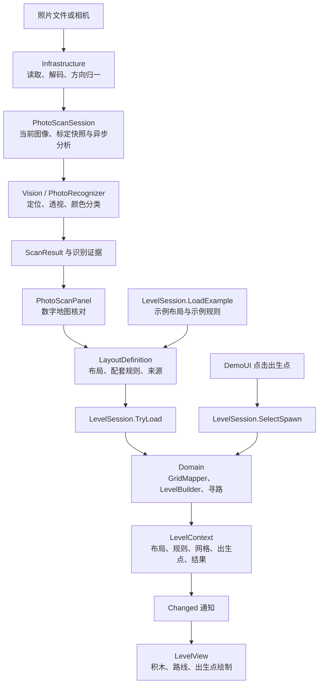

# 项目整体架构

当前是 Unity 关卡生成与路线预览原型：模拟布局或照片识别生成 10×10 实体格，再映射为 20×20 导航格并显示积木和路线。
照片在本地处理。敌人波次、战斗和胜负流程尚未实现。

2026-10-09 的重构已完成五个主要模块划分，并通过 `.asmdef` 显式约束引用；公共数据和既有第三方算法另设基础程序集。

## 五个主要模块

| 模块 | 主要文件 | 职责 |
| --- | --- | --- |
| Domain | `Domain/ExampleScans.cs`、`LevelPipeline.cs`、`GridPathfinder.cs` | 提供配套模拟布局与规则；格位映射、角色与结构校验、四方向 A*、最近可达核心选择。 |
| Vision | `Vision/PhotoRecognizer.cs`、`PlainBackgroundRecognizer.cs`、`BoardLocator.cs`、`ProjectiveMap.cs`、`PhotoModels.cs` | 图像与标定、格纸定位与投影、颜色分类；无格纸背景分割、同色组件拆分和相对布局；拒绝证据与格纸模板。 |
| Application | `Application/LevelSession.cs`、`PhotoScanSession.cs` | 管理当前关卡、输入切换和出生点变更；管理异步照片分析、结果有效性及确认时对应的标定规则。 |
| Presentation | `Presentation/BrickDefenseDemo.cs`、`LevelView.cs`、`DemoUI.cs`、`PhotoScanPanel.cs` | 场景接线、底板/积木/路线绘制、点击选出生点、示例按钮、照片预览、标定控件与数字地图确认。 |
| Infrastructure | `Infrastructure/PhotoFileSource.cs`、`CameraCapture.cs`、`PhotoPixels.cs`、`PhotoProfileStore.cs`、`ScanReportStore.cs` | PNG/JPG 读取与方向归一、相机权限和生命周期、Unity 像素适配、标定持久化、设置和扫描报告读写。 |

上述路径以 `Assets/Scripts/` 为起点。Application 的命名空间为 `BrickDefense.Workflow`，避免与 Unity 的 `Application` 类型冲突。
Domain 和公共数据仍使用既有 `BrickDefense.Core` 命名空间；命名空间兼容不影响程序集边界。

## 基础模块与编译边界

| 程序集 | 显式项目引用 | Unity 引用 |
| --- | --- | --- |
| `BrickDefense.Contracts` | 无 | 禁用 |
| `BrickDefense.Algorithms` | Contracts | 禁用 |
| `BrickDefense.Domain` | Contracts、Algorithms | 禁用 |
| `BrickDefense.Vision` | Contracts、Algorithms | 禁用 |
| `BrickDefense.Application` | Contracts、Domain、Vision | 禁用 |
| `BrickDefense.Infrastructure` | Contracts、Vision | 允许 |
| `BrickDefense.Presentation` | Contracts、Application、Vision、Infrastructure | 允许 |
| `BrickDefense.Editor` | Contracts、Domain、Vision、Application、Infrastructure、Presentation | 仅 Editor 平台 |

- `Contracts/Models.cs` 和 `PhotoEvidence.cs` 保存共享结果与证据 DTO。Domain 可以接收带照片证据的扫描结果，且不引用 Vision 实现。
- `Assets/ThirdParty/` 的 Algorithms 程序集包含既有 Roy 最小堆、js-aruco 标记编码解码和 Colourful 色彩转换子集。通过 `InternalsVisibleTo` 向 Domain 和 Vision 开放实际需要的内部算法类型；来源及授权见 [第三方声明](../THIRD_PARTY_NOTICES.md)。
- `Assets/Editor/` 的场景生成、文件选择器和回归工具单独编译。文件对话框通过回调接入 `PhotoFileSource`，运行时程序集不引用 `UnityEditor`。
- `Tests/` 的 .NET 检查编译纯 C# 模块；Unity 显示与平台读写由编辑器 Play 回归覆盖。

引用方向没有环。Domain 不直接读取文件、使用相机、访问 UI 或 Unity 对象；Presentation 经 Application 改变关卡状态。

## 运行流程

`BrickDefenseDemo` 负责创建模块、连接通知与显示、加载初始示例和注销监听。
`LevelView` 只根据已有的 `LevelResult` 绘制；显示拒绝结果时仍保留可预览的实体。
400 个底板格独立于积木绘制，因此只看到底板不能证明关卡生成成功。

## 关卡状态的唯一更新入口

`LevelSession.Current` 保存当前 `LevelContext`。所有示例、照片确认和出生点变更经同一公开接口更新。

- `LoadExample` 同时选择示例布局和 `demo-*` 规则。
- `TryLoad` 接受一个完整的 `LayoutDefinition`，其中包括布局、规则和来源。它复制输入数组及颜色映射，完成映射和校验后一次性替换当前上下文，再发送 `Changed` 通知。
- 不确定扫描、未映射颜色、畸形输入或缺少核心时不替换当前关卡。
- `NO_ROUTE` 和 `SPAWN_OCCUPIED` 保留实体并允许预览；无有效路线时不绘制路线。
- `SelectSpawn` 拒绝越界坐标，对有效坐标重新计算关卡结果并整体更新上下文。

这个边界解决了之前照片入口更新规则、示例入口只更新网格而出现 `UNMAPPED_COLOR` 的问题。
界面和视图不再分别持有可独立变化的当前网格、规则和路线。

## 照片分析与平台读写

`PhotoScanSession` 保存图像、扫描编号、忙碌状态、耗时和结果。开始分析时复制标定数据；确认成功扫描时，用分析当时的标定创建配套规则。
换图或重新标定会使旧结果失效；较早的异步任务返回时，不能覆盖新输入的状态。

`PhotoInputMode` 显式选择 `MarkedBoard` 或 `PlainBackground`，切换模式也使旧结果失效。
有标记模式沿用 `PhotoRecognizer`，无标记模式调用 `PlainBackgroundRecognizer`；两者都返回相同的 `ScanResult`，因此 Domain 和 LevelSession 无需猜测输入类型。
无格纸没有固定纸面原点，结果标注 `LayoutCoordinateBasis.RelativeBrickScale`，使用图像左上方向与估计边长生成相对离散网格。它不虚构标记或纸张角点，`IsReliable=false` 表示没有定位到真实格纸，逐块测量框仍保存在 ImageEvidence。
低饱和颜色在无格纸模式保留绝对明度，以区别灰背景和白积木；彩色描述继续复用既有 NormalizedLab。相邻组件按尺寸和实际颜色覆盖拆分，L 形中的空区域不会被填满。

照片面板只显示预览和控件，并调用这些接口：

- `PhotoFileSource` 校验 PNG/JPG 类型、32 MB 文件上限和 4096 像素长边上限，返回原文件字节及归一化图像帧。
- `CameraCapture` 管理设备启动、权限、超时、拍摄及停止；面板负责取景预览。
- `PhotoProfileStore` 保持既有 PlayerPrefs 键 `BrickDefense.PhotoCalibration.v1` 和四组颜色的 JSON 格式，读取 `Resources/photo-scan-settings.json`。
- 无格纸模式使用独立键 `BrickDefense.PhotoCalibration.plain.v1`；界面根据当前模式加载、保存或重置标定。颜色角色仍由用户采样的 Core/Wall/Tower 顺序决定。
- `ScanReportStore` 在 `Application.persistentDataPath/Scans/<scanId>/` 保存原文件、方向归一后的 PNG、标定、设置、结果和耗时。

报告增加 `inputMode`、`coordinateBasis`、`direction`、`boardIsReliable`，保留已有字段。无格纸照片预览绘制每个独立对象的测量框；确认后的地图显示为相对布局。

扫描记录用于诊断，当前未实现完整的关卡存档加载系统。

## 数据合同

1. `ScanResult`：100 个实体格的空/占用/不确定状态，独立积木编号、颜色编号、错误和可选照片证据。同色相邻仍是不同积木。
2. `GridResult`：400 个导航格；每块积木占 2×2 导航格，保留来源编号。
3. `LevelRules`：颜色与核心、墙、塔的对应。照片使用 `physical-color-*`，示例使用 `demo-*`，随输入整体提交。
4. `LevelResult`：实体、角色、出生点、目标核心、路线和拒绝原因。
5. `LayoutDefinition` / `LevelContext`：前者是 Application 接收的完整输入，后者是当前输入与所有计算结果的一组上下文。

## 重构验证

- .NET：既有识别与寻路回归、200 个布局的独立 BFS 对照，以及新增的输入切换、失败保留状态、输入快照、出生点和照片确认检查全部通过。
- Unity 6000.3.24f1：在隔离项目实际编译全部程序集，Play 回归通过；纯逻辑程序集无 Unity 引用，运行时程序集无 UnityEditor 引用。
- 实际渲染：普通示例 9 块、16 步路线；包围示例 5 块、`NO_ROUTE`；照片与两个示例反复切换正常。
- 原 AI 生成 PNG 从文件解码到确认及渲染通过：6 蓝、2 红、1 绿，91 个空格；原文件字节和归一化 PNG 像素保存检查通过，标定读写通过。
- 保留已有场景脚本 GUID 和标定格式，场景更新为新的 Presentation 程序集名称。新增资源的 `.meta` 已核对。
- 无格纸实拍扩展：原 JPG 在纯 C# 和 Unity 解码入口均识别 7 橙/2 蓝/1 白、10 个独立方块，确认与实际渲染通过；缩放、颜色角色互换、L 形/2×2 紧贴、未知色、裁切、空背景和模式失效回归通过。

硬件相机、Android 构建及实拍准确率尚未验收。本次验证没有改变这些边界。
前置候选比较、适配和结果见 [重构研究记录](research/architecture-refactor-github.md)。
无标记入口的来源、实现与验收见 [无标记实拍研究](research/markerless-photo-github.md) 和 [v1.1 扩展规范](requirements-markerless-v1.1.md)。
