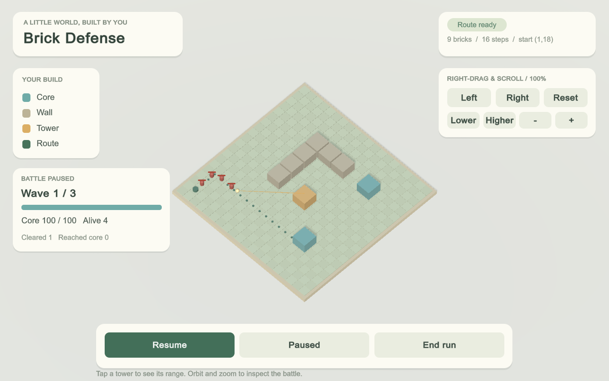
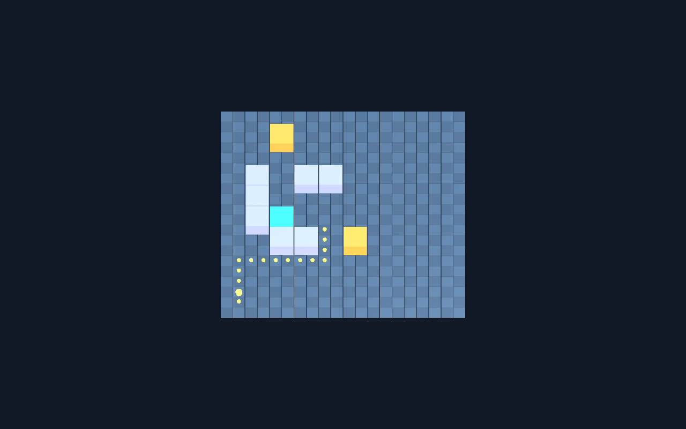

# 验证资料索引与保存约定

整理日期：2026-11-04。范围为原工程 Brick2Life，不包含独立 C 工作区的新功能。

## 当前主线的验证入口

- [当前仿真检查与限制](simulation-baseline-2026-11-04.md)：1076 项纯 C# 断言，以及已有 Unity 回归记录的适用范围。
- [双窗口接线与历史联调](../a-c-integration.md)。
- [采样消隐同步的历史实测](../research/synchronized-projection-blanking-github.md)。

历史结果只说明当时版本、设备和样本下的行为。真实相机识别、实体投影对齐、硬件曝光同步、儿童使用体验不能由 Unity 截图或构造对齐误差代替验收。

## 文件放置规则

| 内容 | 位置与提交规则 |
| --- | --- |
| 产品源码、资源、场景 | `Assets/`、`Packages/`、`ProjectSettings/`，正常提交；Unity 资源配对保留 `.meta` |
| 当前正式检查及必要输入 | `Tests/`、`Tests/Fixtures/`；必要输入、预期结果和生成条件随检查提交，不放入临时证据目录 |
| 需求和任务 | 保持 `.scratch/<feature>/spec.md`、`issues/*.md`、`map.md` 的现有约定，继续提交 |
| 验证结论 | 本目录保存可读摘要，写明版本、日期、命令、结果、限制和资料位置；相关研究记录仍在 `docs/research/` |
| 少量代表截图 | `docs/verification/images/`，注明版本、来源及用途；不把生成图当作实测证据 |
| 完整截图组、日志、扫描副本、RGB 解码数据、一次性探针、隔离工程 | `.scratch/` 本地保存，默认忽略；当前采集数据仍输出到已忽略的 `SimulationCaptures/` |
| 历史源码 | `Archive/BrickDefense/` 保持原样，不参与主线编译；恢复说明见其 [INDEX](../../Archive/BrickDefense/INDEX.md) |

新增正式回归需要使用某个原始输入时，应审查来源和必要性后将最小样本放入 `Tests/Fixtures/`。不能仅因扩展名是图片就把测试输入当作临时文件清理。

`.gitignore` 默认忽略 `.scratch` 内容，允许 Markdown 记录以及本次明确保留的 30 个小型文字证据/历史工具；隔离工程目录继续整体忽略。不要用 `git add -f .scratch` 批量绕过规则。新增必须共享的非 Markdown 证据应优先采用上表的正式目录，并在提交前确认引用。

## 2026-11-04 清理清单

基线提交：`ab7df00acc5a633d5d33d4ce2702a381b4458085`。

- 清理前 `.scratch` 跟踪 195 个文件；保留 90 个需求、任务、文字验证记录及历史工具。
- 停止跟踪 105 个截图、扫描中间数据及一次性调试文件，合计 27,227,600 字节。本地文件不删除。
- 另从历史截图中按原字节保留两张代表图，总计 330,784 字节。它们展示旧系统，不代表当前 UI 或当前实拍能力。
- [逐文件清单](scratch-inventory-2026-11-04.json) 记录每个原路径、分类、处理方式、大小和整理前本地 SHA-256。文本可能受 Git 换行转换影响，清单已注明校验范围。
- 清理未改写 Git 历史，未删除 `Archive`，未迁移到 LFS，也没有上传 Release 附件。减少的是后续提交快照中的文件；普通完整克隆仍可能下载历史对象。

完整历史文件可在[固定提交的 `.scratch` 目录](https://github.com/hanyang-sun/Brick2life/tree/ab7df00acc5a633d5d33d4ce2702a381b4458085/.scratch)查阅。单文件地址为 `historyBaseUrl + files[].path`，值见逐文件清单。历史记录中已有的 Markdown 截图链接已改为固定提交链接，正文中的相对文件名则表示当时本地输出。未曾提交的日志或图片只能在原本机找到，不能保证通过历史链接恢复。

## 历史资料入口

| 资料 | 保留的记录 | 使用边界 |
| --- | --- | --- |
| 仿真工作台和固定相机 | [工作台记录](../../.scratch/task-a-simulation/workspace-view/README.md)、[边框检查](../../.scratch/task-a-simulation/grid-border/README.md) | 早期界面和采样尺寸，不代表当前所有窗口尺寸 |
| B 识别 | [规格](../../.scratch/task-b-recognition/spec.md)、[识别方法和历史验证](../research/fixed-grid-recognition-github.md) | 固定棋盘仿真，不代表真实照片精度 |
| C 投影接线 | [各轮验证记录](../../.scratch/task-c-feedback/verification/README.md) | 含 2022.3 基线、6000.3 验证和之后的接线演进，按日期阅读 |
| 无格纸实拍旧流程 | [说明](../../.scratch/markerless-photo/README.md)、[拒绝回放说明](../../.scratch/scan-rejection/debug/README.md) | 属于旧 BrickDefense；原始扫描数据仅本地或固定历史提交中保留 |
| 旧 Windows 构建与选图 | [构建验收](../../.scratch/windows-release/verification/README.md)、[选图验收](../../.scratch/windows-photo-picker/verification/README.md) | 旧 EXE 和旧入口，不应使用当前项目的命令直接重放 |
| 旧战斗与界面 | [战斗](../../.scratch/combat-a/verification/README.md)、[中文界面](../../.scratch/chinese-ui/verification/README.md)、[布局校对](../../.scratch/layout-review/verification/README.md) | 仅作历史效果和回归范围参考 |
| 旧资产审计 | [逐文件清单](../../.scratch/assets-module-audit/inventory.json)、[审计报告](../brick2life-assets-audit-2026-10-15.md) | 历史结构快照；原工具依赖旧结构，不保证直接重跑 |

其他历史记录继续保留在各功能目录，未重新定义其中的旧需求为当前要求。

## 两张代表图

### 旧战斗画面

来源：`.scratch/combat-a/verification/battle-active-wide.png`，2026-10-11 的隔离 Unity Play 截图，1280×800。用于说明旧战斗效果；不作为当前主线界面验收。

### 旧实拍输入生成的地图

来源：`.scratch/markerless-photo/Artifacts/real-unmarked-photograph.png`。按原说明，这是实拍输入生成的三维地图截图，**不是原始照片**；不据此声称当前主线已具备实拍闭环。

